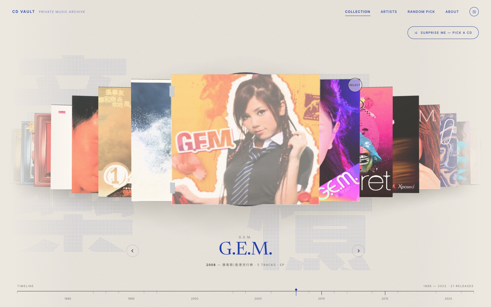
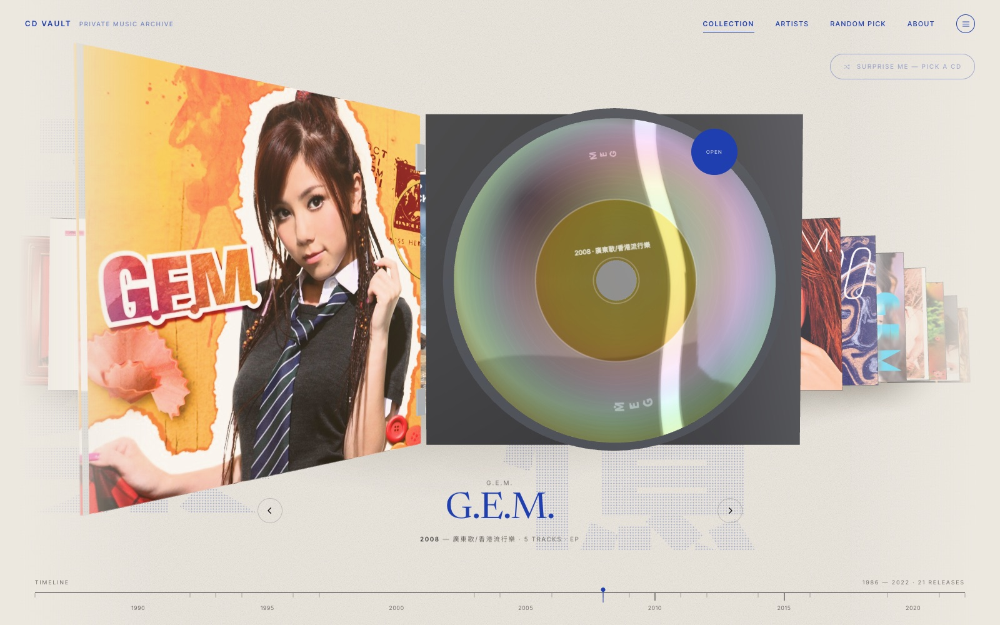
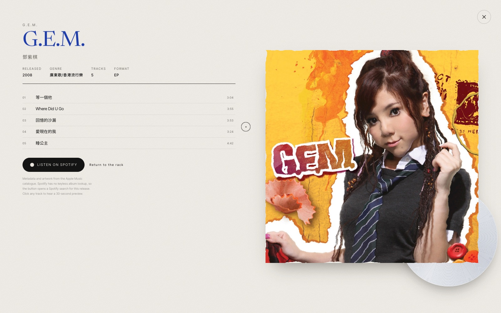

# CD Vault · 私人唱片庫

A private music archive you can actually browse by hand. Twenty-one CD jewel cases from
**G.E.M. 鄧紫棋**, **Joey Yung 容祖兒** and **Jacky Cheung 張學友** stand in a curved rack on warm
paper. Drag along the row, lift a case out, open it and read the liner notes.



---

## What this is

A single-page 3D archive rather than a streaming dashboard. There is no player, no queue, no
algorithm — just a shelf of releases from 1986 to 2022 that you move through with the mouse,
a trackpad or the arrow keys. Every case is modelled as a real jewel case (142 × 125 × 10 mm) with a
transparent hinged lid, a printed spine and a 120 mm disc inside. Picking one lifts it out of the
rack and hinges the lid open; clicking it again expands the album into a full editorial page.

The whole thing is built in React + Three.js and runs entirely in the browser.



---

## Features

- **Curved archive** — cases shrink, recede and rotate toward the centre along an integrated
  scale curve, so the row compresses toward both edges and scrolls infinitely without duplicating
  the catalogue.
- **Photoreal jewel case** — clear lid with real transmission and refraction, hinges, a spine
  insert, a paper booklet edge, a recessed tray and a metallic-rimmed disc.
- **Disc material** — 1.2 mm geometry with a 15 mm spindle hole, PBR metal, a slightly dished normal
  so studio reflections sweep across the surface, and a diffraction shader that tints those
  reflections through the spectrum.
- **Album sheet** — expands out of the cover's projected rectangle via `clip-path`, with the artwork
  bleeding in through an SVG turbulence mask.
- **Release timeline** — rescales to whatever is in the rack; click a year to jump to the nearest
  release.
- **Artist filter**, **random pick**, custom cursor, keyboard navigation, reduced-motion support and
  a dedicated mobile layout.

Clicking the opened case expands its album page — artwork bleeding in through an SVG turbulence
mask, the full tracklist, release facts and a Spotify link.



---

## Run it Online

Link:https://cd-vault.vercel.app/

## Run it locally

**Requirements:** Node.js 18 or newer, and a browser with WebGL 2.

```bash
# 1. get the code
git clone https://github.com/Kathy-Ting-0311/cd-vault-.git
cd cd-vault

# 2. install dependencies
npm install

# 3. start the dev server
npm run dev
```

To make a production build:

```bash
npm run build     # → dist/
npm run preview   # serve dist/ at (e.g.,http://localhost:1080:)
```

> The album artwork is loaded from Apple's image CDN, so the first visit needs an internet
> connection. If a cover fails to load, a generated placeholder is used instead.

---

## How to use it

| Action | What happens |
| --- | --- |
| **Drag** horizontally | Move along the rack; it snaps to the nearest case |
| **Scroll** / **← →** | Step one album at a time |
| **Click a side case** | Bring it to the centre |
| **Click the centre case** | Lift it out and hinge the lid open |
| **Click it again** / **Enter** | Expand the full album page |
| **Esc** / **Return to the rack** | Collapse the page and put the case back |
| **R** / **Surprise me** | Spin the rack, slow down, and open a random release |
| **Click a timeline year** | Jump to the nearest album by release year |
| **Artists** (menu) | Filter the rack to one artist |
| **About** | Credits and shortcuts |

On a phone: swipe to browse, tap the centre case to open it, scroll the album page vertically.

---

## Tech

| | |
| --- | --- |
| Framework | React 19 + TypeScript, Vite 6 |
| 3D | Three.js r186, React Three Fiber 9, drei |
| Motion | GSAP timelines for discrete transitions; a single `useFrame` loop for the rack |
| Styling | Tailwind CSS v4 + a small CSS layer for masks, the sheet and the cursor |

Nothing re-renders React while you drag: the rack reads a mutable controls object each frame and
only the caption updates when the rounded index crosses an album boundary.

---

## Project structure

```
src/
  App.tsx                state machine, drag / wheel / keyboard, catalogue loading
  three/
    ArchiveScene.tsx     canvas, lights, environment dome, camera rig and framing
    CurvedRack.tsx       slot positions, spring, cover-rect readback
    JewelCase.tsx        tray, hinged lid, spine, hinges, disc seat
    Disc.tsx             120 mm geometry + diffraction / groove shader
  ui/
    Nav.tsx  Caption.tsx  Timeline.tsx  DetailSheet.tsx  Cursor.tsx  About.tsx
  lib/
    arc.ts               scale curve, lookup table, pose, wrap
    albums.ts            normalisation of the catalogue
    textures.ts          palettes, spine / label / liner-note canvases
    ease.ts              exact cubic-bezier easing for GSAP
  data/albums.json       21 releases
scripts/fetch-albums.mjs
docs/                    preview images
```

---

## Where the data comes from

`src/data/albums.json` was generated once from the **iTunes / Apple Music Search API** (Hong Kong
store): artwork, tracklists, durations, release years and genres. To rebuild or extend the catalogue,
edit the `PICKS` array in `scripts/fetch-albums.mjs` and run:

```bash
node scripts/fetch-albums.mjs
```

### A note on Spotify

Every album links to Spotify, but the links are **search deep links**
(`open.spotify.com/search/<artist> <album>`), not pinned album pages. Apple's catalogue carries no
Spotify identifiers and Spotify's API requires a client ID and secret to look them up, so nothing
is invented. If you have a real album URL, add it to the album in `albums.json` and the page will
use it instead:

```json
{ "id": "it-1443431909", "spotifyUrl": "https://open.spotify.com/album/..." }
```

Track rows play Apple's 30-second preview clips where available. There is no full-track playback and
the interface does not pretend otherwise.

---

## Accessibility & performance

- Full keyboard navigation with visible focus rings, labelled controls and `aria-modal` dialogs.
- `prefers-reduced-motion` collapses every transition to near-instant and disables the pointer tilt.
- Geometry and materials are created once and shared between cases; only the centred case carries a
  transmissive lid and a disc. Device pixel ratio is capped at 1.75.

---

## Design reference

The layout, curved-archive composition and motion direction are adapted from the VHS-archive
motion template at [motionsites.ai/?prompt=vhs-archive](https://motionsites.ai/?prompt=vhs-archive),
reworked here for CD jewel cases, Traditional Chinese typography and a paper archive.

## License

The code is yours to use. Album artwork, titles and audio previews belong to their respective
rights holders and are referenced from the Apple Music catalogue — this is a personal, non-commercial
archive.
